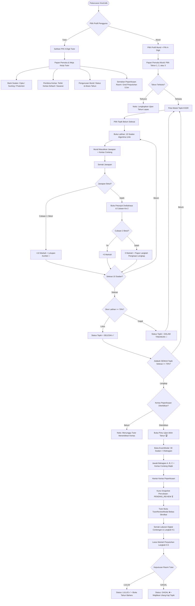

# 📐 KiraCelik Dwibahasa (KSSR Matematik Tahap 1)

> **Buku Latihan Digital & Sistem Penilaian Interaktif Matematik Sekolah Rendah**  
> *Authentic, tactile, bilingual (Bahasa Melayu & English) mastery-based mathematics workbook and exam platform strictly aligned with the Malaysian Ministry of Education KSSR (Semakan 2017) Tahap 1 curriculum (Tahun 1, 2 & 3).*

[](https://react.dev/)
[](https://vitejs.dev/)
[](https://tailwindcss.com/)
[](https://bpk.moe.gov.my/)
[](#-jaminan-kualiti--suite-pengesahan-7878)
[](#-sistem-reka-bentuk--design-system-tactile-neo-brutalism)
[](#-storan--pangkalan-data--persistence--database-layer)
[](#-sistem-reka-bentuk--design-system-tactile-neo-brutalism)
[](https://eslint.org/)
[](LICENSE)

---

## 📑 Isi Kandungan / Table of Contents
1. [Pengenalan & Visi / Overview & Vision](#-pengenalan--visi--overview--vision)
2. [Seni Bina Sistem Penuh / Full System Architecture](#-seni-bina-sistem-penuh--full-system-architecture)
   - [Lapisan Seni Bina / Architectural Layers](#1-lapisan-seni-bina--architectural-layers)
   - [Carta Aliran End-to-End / End-to-End Flow Diagram](#2-carta-aliran-end-to-end--end-to-end-flow-diagram)
   - [Kitaran Hayat Peperiksaan & Pengasingan Snapshot / Exam Lifecycle & Snapshot Isolation](#3-kitaran-hayat-peperiksaan--pengasingan-snapshot--exam-lifecycle--snapshot-isolation)
3. [Sistem Reka Bentuk / Design System (Tactile Neo-Brutalism)](#-sistem-reka-bentuk--design-system-tactile-neo-brutalism)
   - [Falsafah Buku Latihan Kotak / Grid Workbook Philosophy](#1-falsafah-buku-latihan-kotak--grid-workbook-philosophy)
   - [Token Warna & Bayang Fizikal / Color Tokens & Tactile Physics](#2-token-warna--bayang-fizikal--color-tokens--tactile-physics)
   - [Kawalan Skrol & Paparan Bebas Gangguan / Scrollbar Management & Zero Distraction](#3-kawalan-skrol--paparan-bebas-gangguan--scrollbar-management--zero-distraction)
4. [Enjin Soalan & Model Pedagogi / Question Engine & Pedagogical Model](#-enjin-soalan--model-pedagogi--question-engine--pedagogical-model)
   - [Format Ruangan Jawapan Pelbagai / Unified Answer Fields](#1-format-ruangan-jawapan-pelbagai--unified-answer-fields)
   - [Penilai Dwiarah MCQ / Bidirectional MCQ Evaluator](#2-penilai-dwiarah-mcq--bidirectional-mcq-evaluator)
   - [Visual Pedagogi Tanpa Bocor / Zero-Spoiler Pedagogical Visuals](#3-visual-pedagogi-tanpa-bocor--zero-spoiler-pedagogical-visuals)
5. [Subsistem Kertas Conteng / Digital Scratchpad Subsystem](#-subsistem-kertas-conteng--digital-scratchpad-subsystem)
6. [Portal & Meja Kerja Tutor / Tutor Administration Workspace](#-portal--meja-kerja-tutor--tutor-administration-workspace)
7. [Skop Kurikulum KSSR Semakan Tahap 1 / Curriculum Scope](#-skop-kurikulum-kssr-semakan-tahap-1--curriculum-scope)
8. [Struktur Direktori Projek / Project Directory Tree](#-struktur-direktori-projek--project-directory-tree)
9. [Storan & Pangkalan Data / Persistence & Database Layer](#-storan--pangkalan-data--persistence--database-layer)
10. [Jaminan Kualiti & Suite Pengesahan (78/78) / Quality Assurance](#-jaminan-kualiti--suite-pengesahan-7878)
11. [Panduan Pemasangan & Pelaksanaan / Installation & Quick Start](#-panduan-pemasangan--pelaksanaan--installation--quick-start)

---

## 🌟 Pengenalan & Visi / Overview & Vision

**KiraCelik Dwibahasa** ialah aplikasi latihan matematik dan pentaksiran bilik darjah (PBD) progresif yang dibangunkan khusus untuk murid sekolah rendah Tahap 1 (Tahun 1, 2, dan 3; umur 7 hingga 9 tahun) serta tutor pembimbing.

Berbeza dengan perisian latihan digital komersial yang dipenuhi gamifikasi melampau, animasi mengganggu, atau kesan bunyi bising, KiraCelik memegang teguh kepada **Tiga Teras Pedagogi**:
1. **Estetika Buku Latihan Kotak Autentik (*Authentic Square-Grid Workbook*)**: Mengadaptasi rupa bentuk buku tulis matematik fizikal Malaysia dengan kertas bergrid biru lembut (`#E0F2FE`), latar krim hangat siang hari (`#FAF6EE`), dan sempadan dakwat hitam tajam (`#0F172A`).
2. **Dasar Sifar Gangguan Audio (*100% Zero Audio Distraction*)**: Memelihara ketenangan suasana bilik darjah dan fokus murid. Tiada muzik latar atau kesan audio; ganjaran visual diberikan melalui fizik zarah konfeti berwarna-warni (`canvas-confetti`) pada cubaan pertama murid.
3. **Pintu Kelayakan Penguasaan Berperingkat (*Mastery-Based Progression Gate*)**: Murid mesti mencapai skor sekurang-kurangnya **70%** dalam setiap topik sebelum Ujian Peperiksaan Rasmi dibuka. Keputusan akhir (`LULUS` / `GAGAL`) ditentukan secara berdaulat oleh Tutor selepas menyemak lakaran jalan kerja murid pada Kertas Conteng Digital.

---

## 🏛️ Seni Bina Sistem Penuh / Full System Architecture

### 1. Lapisan Seni Bina / Architectural Layers

```
┌─────────────────────────────────────────────────────────────────────────────┐
│                       KIRACELIK SYSTEM ARCHITECTURE                         │
└─────────────────────────────────────────────────────────────────────────────┘
                                       │
┌──────────────────────────────────────▼──────────────────────────────────────┐
│  1. PRESENTATION & INTERACTION LAYER (React 18 + Tailwind CSS)              │
│  • Authentic Workbook Layout: TopNavbar, PinGateModal, PinLoginHomepage     │
│  • Student Modals: PracticeModal (10 Qs), ExamModal (30 Qs / 3 Sections)    │
│  • Tutor Console: QuestionBankTab, PaperBuilderTab, PerformanceTab,         │
│                   StudentManagementTab, QuestionEditorModal,                │
│                   QuestionPreviewModal, TutorReviewModal (.no-scrollbar)    │
│  • Feedback & Celebration: ToastContainer, Canvas Confetti Engine           │
└──────────────────────────────────────┬──────────────────────────────────────┘
                                       │
┌──────────────────────────────────────▼──────────────────────────────────────┐
│  2. DOMAIN & PEDAGOGY ENGINE (Pure JavaScript / Zero External Dependencies) │
│  • questionGenerator.js: Deterministic KSSR 25-Topic Algorithms             │
│  • syllabusConfig.js: KSSR Tahap 1 Curriculum Hierarchy (D1, D2, D3)        │
│  • isAnswerMatch(): Bidirectional MCQ, Numeric, Word, & Operator Evaluator │
│  • normalizeQuestionFields(): Strict Data Sanitization & Split Marks Rule   │
│  • QuestionVisualFigure.jsx: 16+ Zero-Spoiler Scalable Vector Figures (SVG) │
└──────────────────────────────────────┬──────────────────────────────────────┘
                                       │
┌──────────────────────────────────────▼──────────────────────────────────────┐
│  3. DIGITAL SCRATCHPAD ENGINE (HTML5 Canvas 2D)                             │
│  • Normalized Coordinate Space (800 × 480 Internal Resolution)              │
│  • High-DPI Canvas Scaling (window.devicePixelRatio Auto-Compensated)       │
│  • Vector Stroke Array Persistence (Continuous Undo, Redo, Clear)           │
│  • Dual Export: Vector Playback + High-Resolution PNG Base64 DataURL        │
└──────────────────────────────────────┬──────────────────────────────────────┘
                                       │
┌──────────────────────────────────────▼──────────────────────────────────────┐
│  4. PERSISTENCE & SYNCHRONIZATION LAYER (storageService.js)                 │
│  • Primary Store: LocalStorage ('kiracelik_db_v6_pin_reset')                │
│  • Offline-First: Synchronous fast-read + Promise-wrapped async contracts   │
│  • Snapshot Isolation: Exam papers & schemes frozen during active attempts │
│  • Cloudflare D1 Backend: SQLite database (database/schema.sql)             │
│  • Disaster Recovery: Complete JSON Export & Import Workflow                │
└─────────────────────────────────────────────────────────────────────────────┘
```

---

### 2. Carta Aliran End-to-End / End-to-End Flow Diagram



---

### 3. Kitaran Hayat Peperiksaan & Pengasingan Snapshot / Exam Lifecycle & Snapshot Isolation

Salah satu jaminan seni bina terpenting KiraCelik adalah **Pengasingan Snapshot Kertas Peperiksaan (*Exam Snapshot Isolation*)**:
- Apabila murid memulakan peperiksaan, keseluruhan struktur soalan, skema jawapan, dan peruntukan markah dibekukan (*deep clone snapshot*).
- Sekiranya tutor menyunting, memadam, atau mengubah soalan dalam Bank Soalan semasa murid sedang menduduki ujian, cubaan murid yang aktif **tidak akan rosak atau bermutasi**.
- Lakaran Kertas Conteng disimpan dalam dua bentuk: array vektor koordinat untuk semakan resolusi tinggi dan tangkapan imej base64 sebagai arkib tidak boleh ubah (*immutable archive*).

---

## 🎨 Sistem Reka Bentuk / Design System (Tactile Neo-Brutalism)

### 1. Falsafah Buku Latihan Kotak / Grid Workbook Philosophy
Antara muka KiraCelik menolak tema gelap atau gradien neon moden yang menyukarkan pembacaan kanak-kanak. Sebaliknya, aplikasi ini membawakan perasaan fizikal buku latihan matematik sekolah:
- **Corak Grid Matematik (`.bg-math-grid`)**: Garisan linear 1px biru muda `#E0F2FE` dengan saiz grid 28px × 28px menyerupai buku latihan petak murid.
- **Tekstur Kertas (`.bg-math-paper`)**: Titik jejari halus `#E2D9C8` pada selang 24px memberi kedalaman visual tanpa mengganggu teks soalan.

### 2. Token Warna & Bayang Fizikal / Color Tokens & Tactile Physics

| Token Visual | Nilai Heksadesimal | Peranan Pedagogi |
| :--- | :--- | :--- |
| **Kertas Krim Siang** | `#FAF6EE` | Latar belakang utama; mengurangkan silau dan keletihan mata. |
| **Dakwat Sempadan** | `#0F172A` | Sempadan pepejal 2px hingga 3px pada setiap kad, input, dan butang. |
| **Kuning Ambar** | `#FCD34D` / `#F59E0B` | Sorotan tindakan penting, pilihan jawapan terpilih, dan penanda conteng. |
| **Biru Langit** | `#38BDF8` / `#BAE6FD` | Butang navigasi utama, lencana pengenalan, dan ruang interaktif murid. |
| **Hijau Zamrud** | `#34D399` / `#A7F3D0` | Maklum balas jawapan betul, penunjuk topik selesai, dan status lulus. |
| **Mawar Amaran** | `#F43F5E` / `#FFE4E6` | Petunjuk jawapan salah, padam tindakan, dan penanda amaran. |

#### Fizik Butang Taktil (`.btn-tactile`):
```css
.btn-tactile {
  border: 2px solid #0F172A;
  box-shadow: 0 4px 0 #0F172A;
  transition: transform 0.05s ease, box-shadow 0.05s ease;
}
.btn-tactile:active {
  transform: translateY(4px);
  box-shadow: 0 0 0 #0F172A;
}
```

### 3. Kawalan Skrol & Paparan Bebas Gangguan / Scrollbar Management & Zero Distraction
- **Modul Semakan Tutor Bebas Skrolbar (`.no-scrollbar`)**: `TutorReviewModal.jsx` menggunakan kelas utiliti khas yang menyembunyikan palang skrol menegak/mendatar pada WebKit, Firefox, dan IE/Edge sambil mengekalkan keupayaan menatal (*smooth wheel scrolling*).
- **Penguncian Badan Skrin (*Body Scroll Lock*)**: Semasa sebarang modal peperiksaan atau semakan dibuka, `document.body.style.overflow = "hidden"` dikuatkuasakan secara automatik bagi mengelakkan penatalan berlapis (*double-scroll jitter*).

### 4. Sistem Reka Bentuk Impeccable (`adapt`, `harden`, `polish`) & Responsif Telefon Pintar (375px)
- **Impeccable `harden` pada Elemen Dropdown**: Setiap elemen `<select>` dikuatkuasakan dengan kelas `w-full max-w-full min-w-0 truncate text-xs sm:text-sm py-2 px-2.5` bagi menghalang teks tajuk topik atau nama murid daripada melimpah keluar secara mendatar pada skrin `360px–375px`.
- **TopNavbar Responsif Padat**: Bar navigasi atas `TopNavbar.jsx` menyokong pembalutan fleksibel `flex-wrap gap-2 px-3 py-2` dengan pemangkasan teks nama murid dan saiz ikon optimum.
- **Rajah Vektor Impeccable `adapt`**: Kesemua 16+ rajah SVG dalam `QuestionVisualFigure.jsx` dilaraskan kepada `w-full max-w-full h-auto max-h-36 sm:max-h-44 object-contain mx-auto` bersama nisbah aspek tetap `preserveAspectRatio="xMidYMid meet"`. Komponen visual HTML (`BASE10_BLOCKS`, `MONEY_TRAY`, `BENTUK_LAZIM`) menyokong `scale-90 sm:scale-100 origin-center max-w-full flex-wrap` untuk muat padat di dalam kad bersaiz 320px.
- **Pengepala Kertas Conteng 2-Baris Telefon Pintar**: Pada skrin `< 640px`, pengepala Kertas Conteng distrukturkan kepada 2 baris bersih:
  - **Baris 1**: Tajuk (*Kertas Conteng*) di kiri + butang *Expand (⤢)* di kanan.
  - **Baris 2**: Palang alat sentuh 4-kolum seimbang (`grid grid-cols-4 gap-1.5 w-full sm:w-auto sm:flex`) untuk *Pensel*, *Pemadam*, *Undur*, dan *Padam* dengan sasaran sentuhan minimum `40px–44px`.
- **Baris Navigasi Bawah Sebaris Tunggal**: Butang tindakan bawah (`← Sebelumnya`, `Semak Jawapan`, `Seterusnya →`) dioptimumkan kepada saiz padat `text-[11px] sm:text-xs px-2.5 py-1.5` agar muat sempurna dalam satu baris tanpa terpotong pada skrin telefon pintar `360px–375px`.

---

## 🧮 Enjin Soalan & Model Pedagogi / Question Engine & Pedagogical Model

### 1. Format Ruangan Jawapan Pelbagai / Unified Answer Fields
Setiap soalan menyokong gabungan pelbagai jenis ruangan jawapan (`answerFields`) yang dikonfigurasikan secara dinamik oleh tutor:

1. **`NUMERIC`**: Ruangan nombor integer, pecahan (`1/2`), perpuluhan (`0.5`), dan unit sukatan.
2. **`TEXT`**: Ruangan satu baris lebar responsif (`w-full sm:min-w-[340px] md:min-w-[460px]`) khusus untuk murid menaip nombor atau waktu dalam perkataan (contoh: `"jam lapan pagi tepat"`, `"tujuh puluh lima"`).
3. **`MCQ`**: Ruangan aneka pilihan dengan pemilih dropdown abjad (A, B, C, D) untuk tutor semasa pembinaan soalan dan butang pilihan taktil sentuh bagi murid.
4. **`OPERATOR`**: Ruangan simbol operasi matematik berasingan (`+`, `−`, `×`, `÷`) dengan penilai operasi tulen.

### 2. Penilai Dwiarah MCQ / Bidirectional MCQ Evaluator
Enjin penilaian `isAnswerMatch(userVal, expectedAnswer, field)` dalam `questionGenerator.js` menguatkuasakan penyelesaian dwiarah:
- Murid boleh memilih atau menaip huruf kunci opsyen (`"C"`) atau teks nilai opsyen sebenar (`"77"`).
- Enjin secara pintar memadankan kedua-dua bentuk tanpa menjana ralat kekeliruan antara kunci opsyen dan nilai jawapan.
- Bebas 100% daripada pepijat operator lalai (menghalang nilai `expectedOp = "+"` daripada tertumpah ke soalan aneka pilihan).

### 3. Visual Pedagogi Tanpa Bocor / Zero-Spoiler Pedagogical Visuals
Komponen `QuestionVisualFigure.jsx` menghasilkan 16+ rajah matematik berasaskan SVG berskala:
- **Abakus 4:1**: Manik atas bernilai 5, manik bawah bernilai 1 dengan palang pemisah tepat.
- **Blok Asas 10**: Paparan kubus ratus (flat 100), tiang puluh (rod 10), dan unit sa (cube 1) yang diasingkan secara spatial.
- **Geometri 3D Isometrik**: Kubus, kuboid, piramid segi empat, silinder, kon, dan sfera dengan muka teduhan cahaya dan garisan putus-putus terlindung.
- **Dasar Anti-Bocor**: Nilai jawapan pada garis nombor, bentuk lazim (`? ?`), dan label gundal dikosongkan sepenuhnya supaya visual bertindak sebagai stimulus berfikir, bukannya pembocor jawapan.

### 4. Saliran Kemajuan Latihan Topik Pendekatan C / Approach C Topic Practice Progression Pipeline
KiraCelik menguatkuasakan model kemajuan latihan berperingkat yang adil berasaskan **Pendekatan C (Approach C)**:
- **Lapisan 1 — Kalibrasi Kelulusan Set Mikro (*Micro-Part Passing Calibration*)**:
  $$\text{isPartPassed} = (\text{scorePercentage} \ge 70) \lor (\text{totalQuestions} \le 3 \land \text{correctQuestions} \ge 2)$$
  Untuk set mikro (soalan $\le 3$), mendapat 2 daripada 3 soalan betul ($\ge 66\%$) disahkan sebagai **LULUS** bagi bahagian tersebut.
- **Lapisan 2 — Penjejakan Bahagian Lengkap Segera**: ID bahagian rasmi (`part.id`) dimasukkan terus ke dalam `prog.completedPartIds`. Kad topik murid dan tab prestasi tutor memaparkan kemajuan serta-merta (contohnya `1 / 3 Bahagian` sebaik sahaja Bahagian 1 selesai, menyelesaikan masalah paparan `0 / 3 Bahagian`).
- **Lapisan 3 — Markah Terkumpul Berwajaran Topik (*Cumulative Weighted Topic Score*)**:
  $$\text{cumulativeScore} = \text{Math.round}\left(\frac{\sum \text{partScores}}{\text{bilangan bahagian diterbitkan}}\right)$$
  Markah keseluruhan topik dihitung secara purata berwajaran merentasi semua bahagian yang diterbitkan.
- **Lapisan 4 — Promosi Status Topik Lengkap (*Promotion Gate*)**:
  Status topik dipromosikan ke `COMPLETED` hanya apabila **semua bahagian diterbitkan telah diselesaikan** DAN `cumulativeScore >= 70`. Jika tidak, topik kekal berstatus `IN_PROGRESS`.

---

## ✏️ Subsistem Kertas Conteng / Digital Scratchpad Subsystem

Kertas Conteng Digital membolehkan murid melakar langkah pengiraan terus di sebelah soalan:
- **Resolusi Koordinat Dinormalkan (800 × 480)**: Setiap koordinat sentuhan atau tetikus ditukarkan kepada nisbah tetap `800 × 480`. Ini menjamin lakaran murid kelihatan sama persis pada skrin telefon pintar, tablet, mahupun monitor resolusi tinggi 4K.
- **Pengekalan Susunan Vektor (*Vector Stroke Persistence*)**: Setiap garisan disimpan sebagai jujukan titik `{ x, y }` dalam ingatan state, membolehkan fungsi *Undo* tanpa had dan paparan semula segera apabila murid bertukar tab.
- **Penyelarasan Bebas Ralat Konteng**:
  - Keperluan Kertas Conteng dikawal sepenuhnya pada peringkat soalan (`q.scratchpadRequired`).
  - Fungsi `normalizeQuestionFields()` membersihkan sebarang bendera conteng lama sekiranya tutor tidak mewajibkan lakaran, memastikan lencana amaran tidak muncul secara tidak sengaja.

---

## 👨‍🏫 Portal & Meja Kerja Tutor / Tutor Administration Workspace

Portal Tutor menyediakan kawalan pedagogi menyeluruh melalui panel-panel termodular:

```
src/components/tutor/
├── QuestionBankTab.jsx        # Pangkalan soalan (Tapis Tahun, Bahagian, Carian, Muat Naik Gambar)
├── PaperBuilderTab.jsx        # Pembina kertas peperiksaan rasmi (Default atau murid tertentu)
├── PerformanceTab.jsx         # Analisis Penguasaan DSKP (TP1 hingga TP6) & rekod percubaan
├── StudentManagementTab.jsx   # Pengurusan profil murid, tetapan PIN & kunci akses tahun
├── QuestionEditorModal.jsx    # Modal penyuntingan soalan 2-mod (Borang Suntingan + Pratonton Murid)
└── QuestionPreviewModal.jsx   # Paparan interaktif sebenar soalan murid lengkap dengan rubrik tutor
```

### Meja Semakan Peperiksaan Rasmi (`TutorReviewModal.jsx`):
- **Skema Pemarkahan Perpuluhan 0.5**: Tutor boleh memberikan markah pecahan seperti `0.5`, `1.0`, `1.5`, `2.0` mengikut ketepatan kaedah jalan kerja (K1) dan jawapan akhir (N1).
- **Semakan Lakaran Conteng Sebelah-Menyebelah**: Lukisan Kertas Conteng murid dipaparkan bersebelahan jawapan bertulis untuk mengesahkan integriti jawapan.
- **Keputusan Eksplisit**: Butang muktamad `LULUS` atau `GAGAL` bebas daripada peratusan markah angka, memberi kuasa pedagogi sepenuhnya kepada tutor.
- **Sifar Palang Skrol**: Menggunakan utiliti `.no-scrollbar` untuk paparan kemas gred profesional.

---

## 📚 Skop Kurikulum KSSR Semakan Tahap 1 / Curriculum Scope

```
KiraCelik Dwibahasa (25 Modul Pembelajaran KSSR)
├── 📘 TAHUN 1 (8 Topik • Lingkungan 100)
│   ├── Topik 1: Nombor Bulat hingga 100 (Nilai, Tempat, Cerakin, Pola)
│   ├── Topik 2: Operasi Asas (Tambah & Tolak hingga 100, Kumpul Semula, Anu)
│   ├── Topik 3: Pecahan (Pecahan Wajar 1/2, 1/4, 2/4, 3/4)
│   ├── Topik 4: Wang (Syiling hingga RM 1, Wang Kertas hingga RM 10)
│   ├── Topik 5: Masa dan Waktu (Hari, Bulan, Waktu Jam/Setengah Jam)
│   ├── Topik 6: Ukuran dan Sukatan (Panjang, Jisim, Isi Padu Bukan Piawai & cm)
│   ├── Topik 7: Ruang (Bentuk 2D & Bentuk 3D Isometrik)
│   └── Topik 8: Pengurusan Data (Piktograf Asas Skala 1)
│
├── 📙 TAHUN 2 (8 Topik • Lingkungan 1,000)
│   ├── Topik 1: Nombor Bulat hingga 1,000 (Bundar, Pola Nombor, Anggaran)
│   ├── Topik 2: Operasi Asas (Tambah, Tolak, Sifir 2, 3, 4, 5, 10 & Bahagi)
│   ├── Topik 3: Pecahan dan Perpuluhan (Penyebut hingga 10 & Perpuluhan 0.1–0.9)
│   ├── Topik 4: Wang hingga RM 100 (Pendaraban, Pembahagian, Celik Wang)
│   ├── Topik 5: Masa dan Waktu (Senggatan 5 Minit, Jam dan Minit, Kalendar)
│   ├── Topik 6: Ukuran dan Sukatan (Panjang m/cm, Jisim kg/g, Cecair l/ml)
│   ├── Topik 7: Ruang (Ciri Bentuk 3D/2D, Paksi Simetri)
│   └── Topik 8: Pengurusan Data (Carta Gundal & Carta Palang)
│
└── 📕 TAHUN 3 (9 Topik • Lingkungan 10,000)
    ├── Topik 1: Nombor Bulat hingga 10,000 (Bundar hingga Ribu Terdekat)
    ├── Topik 2: Operasi Asas (Operasi Bergabung, Sifir 6, 7, 8, 9, Bahagi Berbaki)
    ├── Topik 3: Pecahan, Perpuluhan & Peratus (Pecahan Setara, Peratus %)
    ├── Topik 4: Wang hingga RM 10,000 (Resit Belanja, Mata Wang ASEAN)
    ├── Topik 5: Masa dan Waktu (Perkaitan Jam/Minit/Saat, Sistem 12/24 Jam)
    ├── Topik 6: Ukuran dan Sukatan (Pertukaran Unit Panjang, Jisim & Isi Padu)
    ├── Topik 7: Ruang (Sudut Tegak, Garis Selari/Serenjang, Perimeter & Luas)
    ├── Topik 8: Koordinat (Satah Koordinat Sukuan Pertama)
    └── Topik 9: Pengurusan Data (Carta Pai Peratus, Piktograf Skala Besar)
```

---

## 📁 Struktur Direktori Projek / Project Directory Tree

```
kiracelik-dwibahasa/
├── database/
│   └── schema.sql                          # Skema SQLite / Cloudflare D1
├── docs/                                   # Spesifikasi & dokumen reka bentuk rasmi
│   ├── 1_product_requirements_document_prd.md
│   ├── 2_system_flow_documentation.md
│   ├── 3_database_design_schema.md
│   ├── 4_architecture_design_system.md
│   └── ... (Spesifikasi DSKP & Dokumen Pembetulan)
├── functions/                              # Cloudflare Pages Functions (API Backend)
│   └── api/
│       ├── db.js                           # Pengendali pangkalan data D1
│       └── sync.js                         # Titik akhir penyegerakan data
├── public/                                 # Aset awam statik
├── scripts/
│   ├── generate_mentor_report.cjs          # Penjana laporan verifikasi mentor
│   ├── run_playwright_qa.mjs               # Ujian E2E visual Playwright
│   └── verify_all.cjs                      # Suite pengesahan automatik 75/75
├── src/
│   ├── components/
│   │   ├── auth/
│   │   │   ├── PinGateModal.jsx            # Modal pengesahan PIN 4-digit
│   │   │   └── PinLoginHomepage.jsx        # Laman log masuk PIN pengguna
│   │   ├── layout/
│   │   │   └── TopNavbar.jsx               # Palang navigasi global & suis BM|EN|Dwibahasa
│   │   ├── tutor/
│   │   │   ├── PaperBuilderTab.jsx         # Pembina kertas peperiksaan tersuai
│   │   │   ├── PerformanceTab.jsx          # Analisis prestasi PBD & rekod ujian
│   │   │   ├── QuestionBankTab.jsx         # Repositori Bank Soalan & tapis tahun
│   │   │   ├── QuestionEditorModal.jsx     # Editor soalan 2-mod (Borang + Pratonton)
│   │   │   ├── QuestionPreviewModal.jsx    # Modal pratonton interaktif paparan murid
│   │   │   └── StudentManagementTab.jsx    # Profil murid, PIN & kawalan akses tahun
│   │   ├── ui/
│   │   │   ├── ConfirmModal.jsx            # Dialog pengesahan taktil
│   │   │   ├── toast.js                    # Utiliti notifikasi ringan
│   │   │   └── ToastContainer.jsx          # Bekas toast maklum balas
│   │   ├── visuals/
│   │   │   └── QuestionVisualFigure.jsx    # Enjin lukisan vektor SVG matematik KSSR
│   │   ├── AnalyticsDashboard.jsx          # Papan pemuka analitis keseluruhan
│   │   ├── ExamModal.jsx                   # Antara muka peperiksaan rasmi 30 soalan
│   │   ├── PracticeModal.jsx               # Antara muka latihan 10 soalan
│   │   └── TutorReviewModal.jsx            # Meja semakan kertas tutor bebas skrolbar
│   ├── engine/
│   │   ├── questionGenerator.js            # Enjin algoritma soalan & pemadanan jawapan
│   │   └── syllabusConfig.js               # Struktur sukatan 25 topik Tahap 1
│   ├── services/
│   │   └── storageService.js               # Lapisan storan LocalStorage v6 & sandaran
│   ├── App.jsx                             # Komponen akar & router keadaan aplikasi
│   ├── index.css                           # Gaya Tailwind, kelas taktil & no-scrollbar
│   └── main.jsx                            # Titik masuk React 18 DOM
├── eslint.config.js                        # Konfigurasi ESLint 9 Flat Config
├── package.json                            # Konfigurasi dependensi & skrip binaan
├── tailwind.config.js                      # Konfigurasi tema Tailwind CSS
└── vite.config.js                          # Konfigurasi pembina pantas Vite
```

---

## 💾 Storan & Pangkalan Data / Persistence & Database Layer

Sistem beroperasi dengan prinsip **Offline-First Resilience** serta **Penyegerakan Dwiarah Masa Nyata Cloudflare D1 (`/api/sync`)**:
- **Kekunci Storan Aktif**: `kiracelik_db_v6_pin_reset`
- **Penyegerakan Awan Dwiarah Real-Time (`functions/api/sync.js`)**:
  - **Pemuatan Awal & Fokus Skrin**: Pada setiap permulaan sesi (`useEffect`), pertukaran profil pengguna, serta apabila tetingkap memperoleh fokus semula (`focus` & `visibilitychange`), aplikasi menghidrat keadaan terkini terus daripada Cloudflare D1 `/api/sync` (`fetchRemoteDB()`).
  - **Penolakan Segera Mutasi**: Setiap mutasi setempat (`updateUserPinSync`, `recordPartPracticeScoreSync`, `addStudentSync`, dll.) disimpan terus ke dalam `localStorage` dan serta-merta mencetuskan penghantaran berkala `pushRemoteDB()` ke `/api/sync`.
  - **Snapshot Nirhilang (*Lossless Full DB Snapshot*)**: Titik akhir Cloudflare D1 menyimpan kedua-dua jadual relasi (`users`, `topic_progress`, `exam_papers`, `exam_attempts`, `custom_questions`, `topic_parts`) serta entri JSON `full_db_snapshot` dalam `app_settings` (`key = 'full_db_snapshot'`). Ini menjamin sifar sifat (`pin_code`, `pin`, `partScores`, `completedPartIds`, `cumulativeScore`) pernah hilang semasa penyegerakan merentas komputer riba tutor dan telefon murid.
- **Struktur Entiti Utama**:
  - `users`: Profil murid dan tutor, kod PIN dwiarah (`pin_code` & `pin`), status akaun (`Active`, `Deactivate`, `Graduate`), dan kawalan akses tahun (`LOCKED` / `UNLOCKED`).
  - `topic_progress`: Status kemajuan topik (`IN_PROGRESS`, `COMPLETED`, `RETAKE_REQUIRED`), markah bahagian terperinci (`partScores`), senarai bahagian lengkap (`completedPartIds`), markah terkumpul berwajaran (`cumulativeScore`), dan bilangan cubaan.
  - `exam_papers`: Koleksi kertas peperiksaan lalai dan peribadi murid mengikut tahun darjah.
  - `exam_attempts`: Rekod percubaan peperiksaan dengan snapshot soalan tidak boleh ubah, markah pecahan perpuluhan 0.5, tangkapan Kertas Conteng, dan keputusan rasmi tutor.
  - `custom_questions`: Soalan yang dicipta atau diubah suai oleh tutor.

---

## 🧪 Jaminan Kualiti & Suite Pengesahan (78/78)

KiraCelik dilengkapi suite ujian pengesahan menyeluruh (`scripts/verify_all.cjs`) yang menguji 78 kes pedagogi dan teknikal:

```bash
node scripts/verify_all.cjs
```

```
=== STARTING KIRACELIK VERIFICATION SUITE ===
--- 1. Testing Original 10 Screenshot Bug Findings --- [10 PASS]
--- 2. Testing Phase 2 Five Follow-Up Screenshot Cases --- [5 PASS]
--- 3. Testing Tutor Decision, Progression & Retakes --- [4 PASS]
--- 4. Testing Question Bank & Paper Builder --- [2 PASS]
--- 5. Testing Student Profiles & Year Access Controls --- [2 PASS]
--- 6. Testing Default Exam Papers across Years 1, 2, 3 --- [3 PASS]
--- 7. Testing Phase 3 Tutor Workspace, Student Statuses & Equation Marking --- [4 PASS]
--- 8. Testing Clean Architecture, Modularity & Asynchronous Persistence --- [5 PASS]
--- 9. Testing 6 Core Architecture & Data Flow Concerns --- [6 PASS]
--- 10. Testing 12 Module Enhancements & Corrections --- [10 PASS]
--- 11. Testing Document 12 Major Corrections --- [5 PASS]
--- 12. Verification for CORRECTION V2 & Cloudflare Local SQL --- [5 PASS]
--- 13. Verification for CORRECTION V3 & Mentor E2E Report --- [4 PASS]
--- 14. Verification for PIN Setup & Redirect Fix (Doc 16) --- [4 PASS]
--- 15. Testing Doc 20: Responsive SVG Scaling & Clean Code --- [6 PASS]
--- 16. Testing Doc 22: PIN Persistence, Approach C Progression & D1 Sync --- [3 PASS]

=== ALL 78 VERIFICATION CHECKS PASSED SUCCESSFULLY ===
```

- **Pematuhan Linter**: `npm run lint` melepasi audit dengan `0 errors, 0 warnings`.
- **Sifar Log Pengeluaran**: Tiada pernyataan `console.log` ditinggalkan dalam kod produksi.
- **Suite Automasi Playwright (15/15 Visual Flows)**: `node scripts/run_playwright_qa.mjs` mengesahkan 15 aliran visual termasuk aliran telefon pintar `375x667` tanpa sebarang limpahan mendatar (`0 overflow detected`).

---

## 🚀 Panduan Pemasangan & Pelaksanaan / Installation & Quick Start

### Keperluan Minimum:
- **Node.js**: Versi `18.0.0` atau ke atas (disyorkan `v20.x` LTS atau `v22.x`)
- **NPM**: Versi `9.0.0` atau ke atas

### 1. Pasang Dependensi
```bash
npm install
```

### 2. Jalankan Pelayan Pembangunan
```bash
npm run dev
```
Buka penyemak imbas anda di `http://localhost:5173/`.

### 3. Jalankan Pengesahan Kod (Linter)
```bash
npm run lint
```

### 4. Jalankan Suite Ujian Lengkap
```bash
node scripts/verify_all.cjs
```

### 5. Bina untuk Pengeluaran (Production Build)
```bash
npm run build
```
Folder `dist/` bersedia untuk dideploy terus ke Cloudflare Pages, Vercel, Netlify, atau GitHub Pages.

---

## 📄 Lesen / License
Projek ini dilesenkan di bawah [MIT License](LICENSE). Diterbitkan untuk tujuan peningkatan kualiti pendidikan matematik sekolah rendah di Malaysia.
