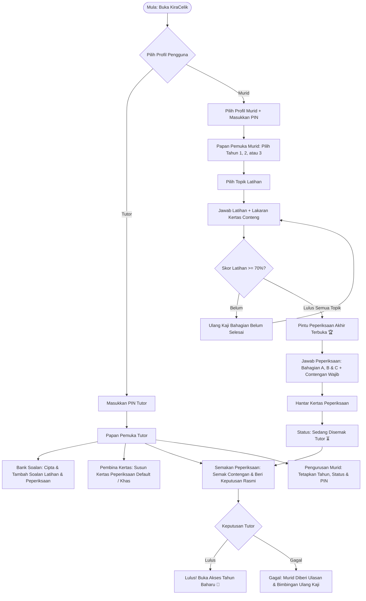

# 📐 KiraCelik

> **Buku Latihan Digital & Sistem Pentaksiran Matematik KSSR Tahap 1 (Tahun 1, 2 & 3)**  
> Platform latihan matematik interaktif bertaraf bilik darjah yang mesra murid, autentik seperti buku latihan sekolah, dan dilengkapi portal pengurusan lengkap untuk tutor.

🌐 **Live Website:**  
👉 **[https://kiracelik-dwibahasa.pages.dev](https://kiracelik-dwibahasa.pages.dev)**

---

## 🌟 Pengenalan

**KiraCelik** dibangunkan khusus untuk membantu murid sekolah rendah (Tahun 1, 2, dan 3) menguasai asas matematik mengikut sukatan rasmi **KSSR Semakan Kementerian Pendidikan Malaysia (KPM)**.

Aplikasi ini menggabungkan pengalaman latihan digital yang interaktif bersama pemantauan langsung oleh **Tutor**. Murid berlatih mengikut topik, membuat pengiraan pada **Kertas Conteng Digital**, dan menduduki peperiksaan yang disemak secara teliti oleh tutor.

---

## ✨ Ciri-Ciri Utama

### 1. 👦 Untuk Murid
* **Latihan Mengikut Topik (Tahun 1, 2 & 3):** Meliputi semua topik sukatan KSSR (Nombor Bulat, Operasi Asas, Pecahan, Wang, Masa, Ukuran, Ruang, dan Pengurusan Data).
* **Kertas Conteng Digital:** Ruang khas untuk membuat jalan kerja dan bentuk lazim terus di sebelah soalan (mudah digunakan dengan jari di telefon atau tetikus di komputer).
* **Pilihan Bahasa Fleksibel:** Menyokong Bahasa Melayu (BM) dan Bahasa Inggeris (EN).
* **Maklum Balas Segera:** Semakan automatik dengan petunjuk jalan kerja dan animasi konfeti apabila menjawab dengan betul.
* **Peperiksaan Akhir Tahun:** Kertas peperiksaan rasmi dibuka secara automatik setelah murid melengkapkan topik latihan dengan markah penguasaan sekurang-kurangnya 70%.

### 2. 👨‍🏫 Untuk Tutor
* **Bank Soalan Lengkap & Tersuai:** Tutor boleh **mencipta, menyunting, dan menambah soalan baharu** — sama ada untuk latihan harian topik mahupun untuk soalan kertas peperiksaan!
* **Pembina Kertas Peperiksaan:** Cipta kertas peperiksaan rasmi secara tersuai (boleh disasarkan kepada semua murid atau murid tertentu).
* **Semakan Peperiksaan & Gred Perpuluhan:** Tutor menyemak contengan jalan kerja murid dan memberikan markah fleksibel (termasuk markah separuh `0.5`, `1.0`, `1.5`) serta ulasan bimbingan.
* **Kuasa Penuh Keputusan Lulus/Gagal:** Tutor mempunyai budi bicara penuh untuk menentukan sama ada murid layak untuk dinaikkan ke tahun akademik berikutnya.
* **Pengurusan Profil Murid:** Kawal akses tahun (Tahun 1, 2, 3), tukar PIN murid, atau tetapkan status akaun (Aktif, Nyahaktif, atau Tamat).
* **Edit Profil Tutor:** Tutor boleh menukar nama, ikon avatar, dan kod PIN akaun sendiri dengan mudah.

### 3. ☁️ Penyegerakan Awan Automatik (Cloudflare D1)
* Data disegerakkan secara automatik merentasi semua peranti. Murid boleh menjawab latihan di telefon pintar atau tablet, dan tutor boleh menyemak markah di komputer riba tanpa kehilangan sebarang rekod.

---

## 🔄 Carta Aliran Sistem (End-to-End Workflow)



> 💡 **Nota Penting**: Soalan latihan topik dan kertas peperiksaan tidak terhad kepada soalan asal sahaja. Tutor bebas menambah dan menguruskan soalan tersuai (aneka pilihan, padanan nombor, perkataan, atau bentuk lazim) ke dalam Bank Soalan pada bila-bila masa!

---

## 💻 Panduan Menjalankan Projek (Quick Start)

### Keperluan Asas:
* **Node.js**: Versi `18.0.0` atau terkini
* **NPM**: Disertakan bersama Node.js

### 1. Pasang Pakej (Dependencies)
```bash
npm install
```

### 2. Jalankan Pelayan Tempatan (Local Development)
```bash
npm run dev
```
Buka pautan `http://localhost:5173` pada pelayar web anda.

### 3. Jalankan Ujian Pengesahan Automatik (Verification Suite)
```bash
node scripts/verify_all.cjs
```
*(Menguji semua 78 semakan ketepatan pedagogi, algoritma matematik, dan keselamatan data).*

### 4. Bina Aplikasi untuk Pengeluaran (Production Build)
```bash
npm run build
```

### 5. Deploy ke Cloudflare Pages
```bash
npx.cmd wrangler pages deploy dist --project-name=kiracelik-dwibahasa --branch=production
```

---

## 🛠️ Teknologi yang Digunakan
* **Frontend:** React 18, Vite 5, Tailwind CSS
* **Ikon & Tipografi:** Lucide React, Google Fonts (Space Mono & Fredoka)
* **Backend & Pangkalan Data:** Cloudflare Pages Functions, Cloudflare D1 (SQLite)
* **Pengesahan & Ujian:** Playwright E2E, ESLint, Node.js Test Suite

---

## 📄 Lesen
Projek ini dilesenkan di bawah [MIT License](LICENSE). Diterbitkan untuk tujuan peningkatan kualiti pendidikan matematik sekolah rendah di Malaysia.
